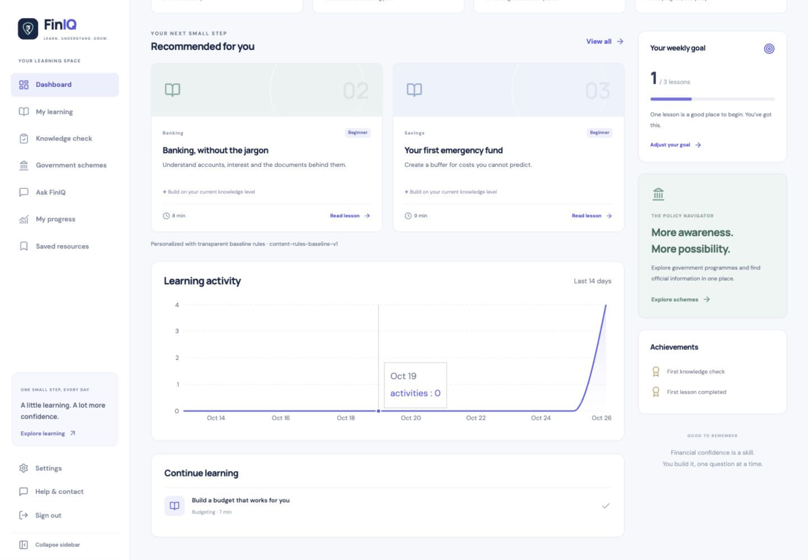

# FinIQ verification record

Verified locally on 26 October 2026. This record describes observed results, not a claim of exhaustive testing or production certification.

## Builds and automated tests

| Check | Result |
| --- | --- |
| React `npm test` | 10 tests passed in 3 files |
| React `npm run build` | Production Vite build passed |
| Java `python3 scripts/test-backend.py` | 3 JUnit tests passed, including a comprehensive real HTTP/PostgreSQL/Python integration test |
| Java Maven `package -DskipTests` | Executable Spring Boot JAR built; tests run separately above |
| Python `.venv/bin/python -m pytest -q`, from `ml-service` | 5 tests passed |
| Docker Compose build and startup | All four services healthy: Nginx/React, Spring Boot, PostgreSQL 17, FastAPI |
| Native and packaged API smoke workflows | Passed |

The Python command must run from `ml-service` so its `app` package is importable. A root-directory invocation failed collection; the documented command above passed. Non-fatal test warnings concern React Router future flags in test harnesses and Starlette's deprecated AnyIO alias.

## Verified workflows

- Registration, validation, password hashing/login, protected endpoints, role denial, logout revocation, password-reset expiry/single use and revocation of prior tokens. Reset delivery used the private development file mode, not SMTP.
- Seven-question onboarding and lesson quiz submissions; scores calculated on the server, incomplete/invalid answers rejected, answers not disclosed before submission, and results restricted to their owner.
- Java calls the running Python classification, recommendation, source retrieval and institution risk endpoints. Tests assert the actual method identifiers; deliberate ML unavailability also exercises the explicit fallback.
- Lesson visits, idempotent completion, bookmarks, progress, assessment history, recommendations excluding completed lessons, scheme search and dynamic scheme filters.
- Contact submission, administrator content CRUD and field allowlisting, locked attempted assessment definitions, institution membership scope and denied cross-role access.
- Learner progress survived a restart of both the Compose database and backend. After the subsequent V4 migration/rebuild, re-login returned the same completed lesson and at least two persisted achievement award records.
- Browser sign-in, dashboard, lesson completion, saving a lesson, quiz submission/results, English/Hindi navigation and a Hindi question returning sourced retrieval results.
- Browser administrator sign-in, listing records, creating a synthetic topic, and reopening its saved description. The clearly labeled `QA browser verification` topic remains as test data in the local Compose database.
- Responsive views inspected at 1440×1000, 768×1024 and 390×844. Inspected pages had matching viewport/document widths without horizontal overflow; mobile navigation and quiz controls were exercised. This is not an exhaustive device/browser matrix.

## Errors found and fixed

- Explicit JPA `topic_id` mapping resolves duplicate column mapping at startup.
- Scroll-reset effect no longer returns a browser-provided Promise as a React cleanup function, preventing navigation crashes.
- Optional SMTP health checking no longer makes an otherwise working local stack unhealthy.
- Closed mobile navigation is hidden from keyboard focus; responsive spacing and muted text contrast improved.
- Administrator-created scheme regions are exposed through API-driven filters.
- Achievement awards are stored with timestamps rather than depending exclusively on current activity calculations.
- JWT claim validation, attempted-assessment edit protection and definition locking were hardened.
- An expired token previously caused the sign-out button to leave the protected screen visible. HTTP 401 now clears local authentication; other failures still report an error. Two regression tests cover expired-session and network-failure behavior.

## Running environments

The packaged app is at **http://localhost:8088** and the native development frontend is at **http://localhost:5173**. They use separate PostgreSQL databases. The native database is isolated on port 55432; an unrelated existing PostgreSQL service was not modified. Compose stores its database in a named volume. Do not run `docker compose down -v` if you want to retain that data.

Use the root README for setup, launch, administrator configuration and repeatable test commands. Generated secrets and test credentials remain in ignored private local files. No credentials are embedded in this report.

## Remaining limits

- Live SMTP email delivery needs an authorized provider configuration and has not been verified. Compose disables password-reset delivery by default; native development links are private local files.
- Classification, recommendations and support indicators are transparent baselines. Retrieval uses TF-IDF over supplied content, with limited Hindi query expansion. No trained predictive model, embeddings, external LLM or validated accuracy claim is included; a suitable labeled dataset/evaluation would be required for those claims.
- Hindi navigation and core interface strings are available, but source passages and some explanatory/admin text remain English. The included catalogue is a small educational seed dataset, not an exhaustive or continuously updated scheme database.
- Public AWS deployment, TLS/domain configuration, live mail, backup restoration, load testing and independent security/accessibility audits were not performed. Deployment guidance is supplied separately.

